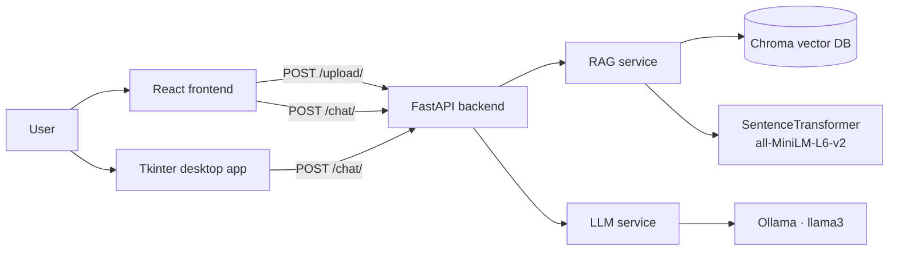

# AI Knowledge Chatbot

A document-grounded AI chatbot: upload a PDF (including scanned PDFs) or a
text file, then ask questions about it in natural language. Answers are
generated locally by an LLM and grounded in your documents with
Retrieval-Augmented Generation (RAG) — no document content is sent to a
hosted AI API.

Built by **Lakshman Sai Yaganti** — Data Scientist (FinTech, payments,
fraud detection and credit risk), currently at Square.

- GitHub: https://github.com/LakshmanYaganti
- LinkedIn: https://www.linkedin.com/in/y-lakshman/
- Portfolio: https://lakshmanyagantiportfolio.lovable.app/
- Email: lakshmanyaganti47@gmail.com

## Features

- **Chat with your documents** — upload a document once, then ask questions;
  the most relevant passages are retrieved and used as context for the answer.
- **PDF + OCR support** — text-based PDFs are parsed directly; scanned PDFs
  fall back to OCR (Tesseract via `pytesseract` + `pdf2image`).
- **Plain-text support** — `.txt` files are ingested the same way as PDFs.
- **Fully local LLM** — generation runs through [Ollama](https://ollama.com/)
  with `llama3`; if Ollama is not running, the API returns a clear,
  actionable message instead of an error page.
- **Three clients, one API** — a React web UI, a Tkinter desktop app, and
  the REST API itself.
- **Friendly failure modes** — chatting before any document is uploaded
  works (the model answers without document context), and unsupported
  file types are rejected with a `400` explaining what is allowed.

## Architecture



How a question flows: the backend embeds the question, retrieves the three
most similar document chunks from Chroma, and passes them to Ollama as
context alongside the question.

## Tech Stack

| Layer | Technology |
| --- | --- |
| Backend API | FastAPI, Uvicorn, Pydantic |
| RAG / vector store | LangChain, Chroma |
| Embeddings | SentenceTransformers — `all-MiniLM-L6-v2` |
| LLM | Ollama — `llama3` (local) |
| Document parsing | PyPDF, Tesseract OCR (`pytesseract`, `pdf2image`) |
| Web frontend | React, Vite, Axios |
| Desktop app | Python, Tkinter, Requests |

## Project Structure

```
ai-chatbot-app/
├── backend/
│   ├── .env.example          # Copy to .env (optional — defaults work)
│   ├── requirements.txt
│   └── app/
│       ├── main.py           # FastAPI app, CORS, / and /health
│       ├── models/
│       │   └── chat_model.py # ChatRequest / ChatResponse schemas
│       ├── routes/
│       │   ├── chat.py       # POST /chat/
│       │   └── upload.py     # POST /upload/ (PDF/.txt, validated)
│       ├── services/
│       │   ├── llm_service.py    # Ollama call + graceful fallback
│       │   └── rag_service.py    # Ingest + retrieve from Chroma
│       └── utils/
│           ├── document_loader.py # PDF / OCR / .txt loading + chunking
│           └── embeddings.py      # SentenceTransformer embeddings
├── frontend/                 # React + Vite web UI
│   └── src/
│       ├── App.tsx           # Entry — renders the chat page
│       ├── pages/ChatPage.jsx    # Page + document upload UI
│       └── components/
│           ├── Chatbox.jsx   # Chat box (loading, Enter-to-send, errors)
│           └── Message.jsx   # Single user/bot message bubble
└── desktop_app/
    └── desktop_ai_chatbot.py # Tkinter desktop client
```

## Setup

### Prerequisites

- Python 3.10+
- Node.js 18+ (for the web frontend)
- [Ollama](https://ollama.com/) installed, with the model pulled:
  `ollama pull llama3`
- For scanned-PDF OCR only: Tesseract and Poppler installed on your system

### 1. Backend

```bash
cd backend
python -m venv .venv && source .venv/bin/activate   # Windows: .venv\Scripts\activate
pip install -r requirements.txt
cp .env.example .env        # optional
uvicorn app.main:app --reload --port 8000
```

API docs: http://localhost:8000/docs · Health check: http://localhost:8000/health

### 2. Frontend (web)

```bash
cd frontend
npm install
npm run dev
```

Open the URL Vite prints (default http://localhost:5173). The frontend
expects the backend at `http://localhost:8000`; override with
`VITE_API_BASE_URL` if needed.

### 3. Desktop app

With the backend running:

```bash
pip install requests
python desktop_app/desktop_ai_chatbot.py
```

## API

| Method | Endpoint | Request | Response |
| --- | --- | --- | --- |
| GET | `/` | — | `{"message": "AI Chatbot API Running"}` |
| GET | `/health` | — | `{"status": "ok", "service": "AI Knowledge Chatbot"}` |
| POST | `/chat/` | `{"message": "string"}` | `{"response": "string"}` |
| POST | `/upload/` | `multipart/form-data` with a `file` field (`.pdf` or `.txt`) | `{"message": "Document processed successfully", "filename": "…"}` |

## Environment Variables

| Variable | Where | Default | Purpose |
| --- | --- | --- | --- |
| `OLLAMA_MODEL` | `backend/.env` | `llama3` | Ollama model used for generation |
| `VITE_API_BASE_URL` | frontend environment | `http://localhost:8000` | Base URL of the backend API |

## How RAG Works

1. **Ingest** — an uploaded file is loaded (PyPDF, OCR fallback for scanned
   pages, or the text loader for `.txt`), split into 500-character chunks
   with 50 characters of overlap, embedded with `all-MiniLM-L6-v2`, and
   stored in a local Chroma database (`vector_db/`).
2. **Retrieve** — a question is embedded with the same model and the three
   most similar chunks are fetched. If nothing has been ingested yet, the
   retriever returns no context instead of failing.
3. **Generate** — the retrieved chunks and the question are combined into a
   single prompt for the local `llama3` model via Ollama.

## Limitations

- Answers are only as good as the uploaded documents and the local model;
  there is no web search or conversation memory between messages.
- The vector store and uploaded files are local, single-user, and not
  persisted anywhere else — deleting `vector_db/` resets the knowledge base.
- OCR quality depends on scan quality and on Tesseract/Poppler being
  installed; very large PDFs are processed page-by-page and can be slow.
- CORS is currently open (`*`) for local development; restrict
  `allow_origins` in `backend/app/main.py` before deploying publicly.

## License

MIT — see [LICENSE](LICENSE). © 2026 Lakshman Sai Yaganti.
